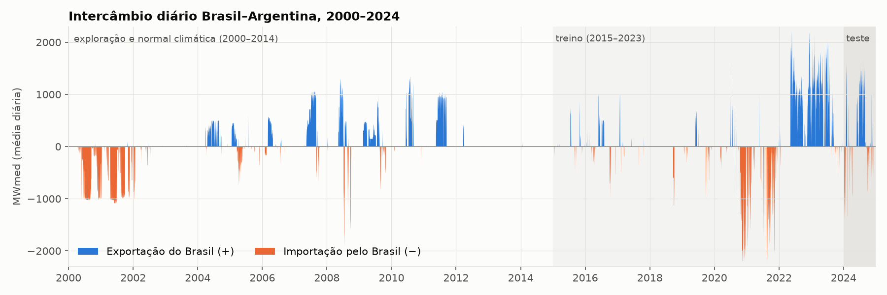
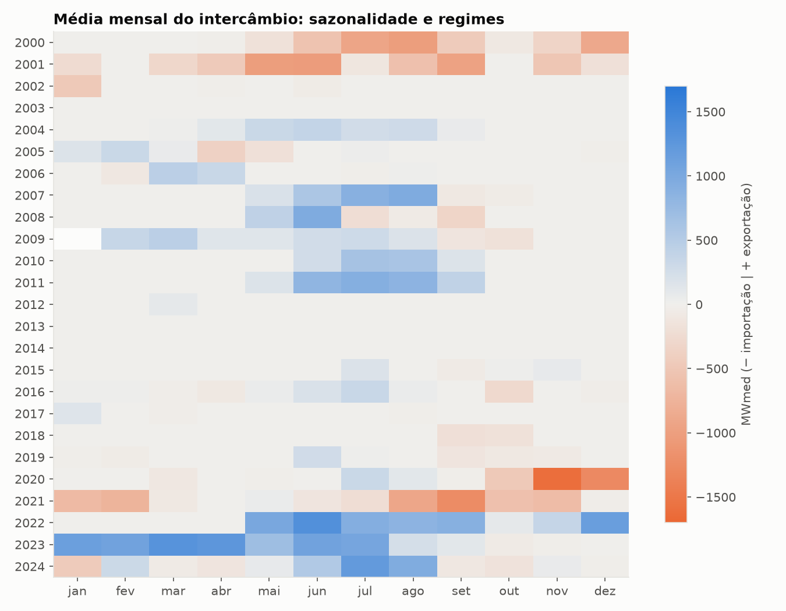
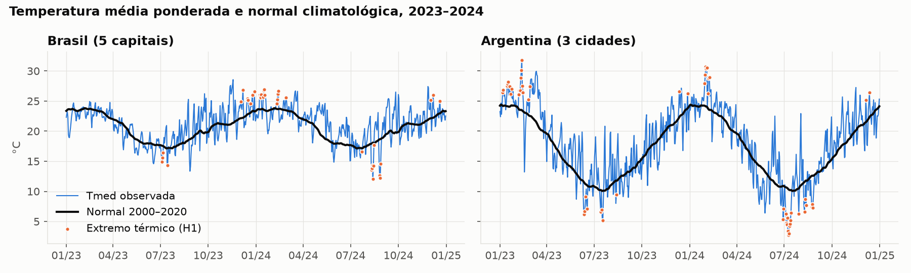
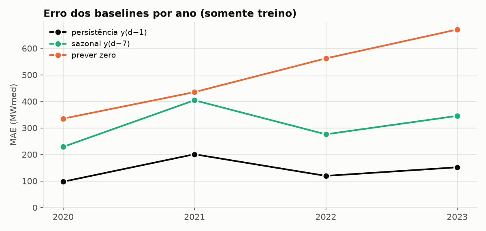

# Intercâmbio de energia Brasil–Argentina: clima, calendário e previsão

Trabalho da disciplina de Ciência de Dados. O objetivo é entender como clima, calendário, água nos reservatórios, preço da energia e economia se relacionam com o fluxo de energia entre o Brasil e a Argentina, e testar se modelos de aprendizado de máquina conseguem prever o fluxo médio do dia seguinte.

| Etapa | Data | Entrega |
|---|---|---|
| 1. Definição do problema | 10/11 | proposta |
| 2. Preparação e integração | 17/11 | scripts, notebook e bases em Parquet |

## Fontes de dados

Todos os dados são públicos. O script `src/coleta.py` baixa tudo automaticamente.

| Dado | Fonte | Período |
|---|---|---|
| Intercâmbio Brasil–Argentina (horário, MWmed) | ONS, Portal de Dados Abertos: [Intercâmbio do SIN com Outros Países](https://dados.ons.org.br/dataset/intercambio-internacional) | 2000–2024 |
| Energia Natural Afluente (ENA) | ONS: [ENA Diário por Subsistema](https://dados.ons.org.br/dataset/ena-diario-por-subsistema) | 2000–2024 |
| Energia Armazenada (EAR) | ONS: [EAR Diário por Subsistema](https://dados.ons.org.br/dataset/ear-diario-por-subsistema) | 2000–2024 |
| Carga de energia | ONS: [Carga de Energia Diária](https://dados.ons.org.br/dataset/carga-energia) | 2000–2024 |
| Custo Marginal de Operação (CMO) | ONS: [CMO Semanal](https://dados.ons.org.br/dataset/cmo-semanal) | 2005–2024 |
| Energia vertida turbinável | ONS: [Energia Vertida Turbinável](https://dados.ons.org.br/dataset/energia-vertida-turbinavel) | 2015–2024 |
| CMO semi-horário (usado só para conferir o CMO semanal no notebook) | ONS: [CMO Semi-Horário](https://dados.ons.org.br/dataset/cmo-semi-horario) | 2021–2022 |
| Temperatura média, máxima e mínima (8 cidades) | Open-Meteo: [Historical Weather API](https://open-meteo.com/en/docs/historical-weather-api) (dados ERA5) | 2000–2024 |
| IBC-Br (atividade econômica do Brasil) | Banco Central do Brasil: [SGS](https://www3.bcb.gov.br/sgspub/), série 24363 | 2003–2024 |
| Câmbio peso argentino/dólar (A3500, BCRA) | Governo argentino: [API de Series de Tiempo](https://apis.datos.gob.ar/series/api/series/?ids=168.1_T_CAMBI500_D_0_0_17), série `168.1_T_CAMBI500_D_0_0_17` | 2002–2024 |
| EMAE (atividade econômica da Argentina, INDEC) | [API de Series de Tiempo](https://apis.datos.gob.ar/series/api/series/?ids=143.3_NO_PR_2004_A_21), série `143.3_NO_PR_2004_A_21` | 2004–2024 |
| Feriados do Brasil e da Argentina | biblioteca Python [holidays](https://pypi.org/project/holidays/) | 2000–2025 |
| População das cidades (peso de cada cidade no clima) | [IBGE, Censo 2022](https://censo2022.ibge.gov.br/) e [INDEC, Censo 2022](https://www.indec.gob.ar/indec/web/Nivel4-Tema-2-41-165) (resultados provisórios) | 2022 |

## Como executar

```bash
python3 -m venv .venv
.venv/bin/pip install -r requirements.txt
.venv/bin/python -m src.pipeline
```

Na primeira vez, o download leva de 10 a 15 minutos, porque só os dados de vertimento do ONS têm cerca de 2 GB. Depois os arquivos ficam salvos em `data/raw/` e tudo roda em poucos segundos. O notebook [notebooks/02_preparacao_integracao.ipynb](notebooks/02_preparacao_integracao.ipynb) roda o pipeline e mostra as checagens e os gráficos.

## Estrutura

```
src/
  config.py       períodos, cidades, pesos e as 41 variáveis por bloco
  coleta.py       baixa e limpa os dados: ONS, Open-Meteo, BCB, datos.gob.ar e feriados
  integracao.py   junta tudo por data e gera as bases
  pipeline.py     roda a coleta e a integração
notebooks/02_preparacao_integracao.ipynb
data/raw/        arquivos baixados
data/interim/    cada fonte já limpa, em Parquet
data/processed/  bases finais em Parquet + grupos_variaveis.json
reports/figuras/ gráficos do notebook
```

## Bases geradas

| Arquivo | Conteúdo | Uso |
|---|---|---|
| `intercambio_argentina_horario.parquet` | 217.373 horas (2000–2024) | exploração e consultas SQL |
| `base_diaria_integrada.parquet` | 9.132 dias × 72 colunas, com os valores do próprio dia | H1, H2 e H4 |
| `base_modelagem_t1.parquet` | 3.652 dias (2015–2024) × 47 colunas: o alvo e as 41 variáveis | H3 (previsão); a coluna `particao` separa treino e teste |

```python
import json, pandas as pd
base = pd.read_parquet("data/processed/base_modelagem_t1.parquet")
blocos = json.load(open("data/processed/grupos_variaveis.json"))
treino, teste = base[base.particao == "treino"], base[base.particao == "teste"]
```

## Recorte dos dados

Usamos os dados de 2000 a 2024 para explorar a série e para calcular a temperatura normal de cada dia do ano (média de 2000 a 2020).

Para os modelos, o treino vai de **2015 a 2023** e o teste é **2024**. Na proposta da etapa 1, o treino era de 2021 a 2023. Mudamos por três motivos:

1. Os dados de energia vertida turbinável do ONS só começam em 2015.
2. Em 2024 o Brasil importou energia em cerca de 21% dos dias e exportou em 34%. Treinando só com 2021–2023, o modelo veria um único ano com importação (2021). Com 2015–2023, ele vê importações em 2016, 2019, 2020 e 2021.
3. De 2003 a 2014 quase não houve fluxo, e o CMO só existe a partir de 2005.

A coluna `recorte_original_2021` permite rodar os modelos também com o recorte da proposta, para comparar.

## Como evitamos vazamento de dados

Para prever o dia *d*, o modelo só pode usar o que já se sabia no fim do dia anterior (d−1):

| Bloco | O que pode usar |
|---|---|
| Histórico | o fluxo até d−1 |
| Calendário | o próprio dia *d*, porque feriados e dias da semana são conhecidos antes |
| Clima | temperaturas até d−1 (não usamos previsão do tempo) |
| Hidrologia e carga | valores do ONS até d−1 |
| Preço (CMO) | a última semana já fechada até d−1 |
| Economia | câmbio de d−1; IBC-Br e EMAE só 60 dias depois do fim do mês, quando já foram divulgados |

Sobre o CMO: o ONS marca cada semana com a data da sexta-feira em que ela termina, e o valor é a média da semana inteira. Se usássemos a semana atual, estaríamos usando dias que ainda não aconteceram. Conferimos isso comparando com o CMO semi-horário (seção 6 do notebook).

No período de modelagem falta só um dia de intercâmbio (09/04/2015). Para calcular as defasagens, ele recebe o valor do dia anterior, mas não entra como alvo.

## Variáveis usadas (41)

Na exploração, testamos 163 variáveis. Para escolher as 41, olhamos só os dados de treino (2015–2023) e usamos quatro critérios:
- a variável precisa fazer sentido para o problema;
- precisa ter relação com o fluxo;
- não pode repetir a informação de outra variável;
- não pode ter tendência ao longo dos anos. Por isso, câmbio e atividade econômica entram como variação, e não pelo valor.

Algumas entram mesmo com relação fraca, porque as hipóteses precisam delas: extremos de temperatura (H1), feriados (H2) e CMO (H4). A lista fica em `src/config.py`.

Sufixos: `_l1` = valor de ontem; `_mm7` e `_mm3` = média dos últimos 7 e 3 dias; `_7d` = soma dos últimos 7 dias; `_var` = variação.

### Histórico do intercâmbio (8)

| Variável | O que é |
|---|---|
| `hist_lag1` | fluxo médio de ontem |
| `hist_lag2` | fluxo médio de anteontem |
| `hist_lag7` | fluxo médio de 7 dias antes |
| `hist_mm7` | média do fluxo nos últimos 7 dias |
| `hist_abs_mm7` | média da intensidade do fluxo (sem sinal) nos últimos 7 dias |
| `hist_media_ult6h_l1` | média do fluxo das 18h às 23h de ontem |
| `hist_horas_export_l1` | horas exportando ontem |
| `hist_horas_import_l1` | horas importando ontem |

**Por quê:** o fluxo muda pouco de um dia para o outro. Em 67% dos dias ele fica igual ao do dia anterior, e a correlação entre o valor de ontem e o de hoje é 0,87. O fim do dia anterior e as horas em cada sentido mostram para onde o fluxo está indo. O `hist_lag7` é o baseline sazonal da proposta.

### Calendário (9)

| Variável | O que é |
|---|---|
| `cal_mes`, `cal_sen_anual`, `cal_cos_anual` | mês e posição no ano |
| `cal_dia_semana`, `cal_fim_de_semana` | dia da semana e fim de semana |
| `cal_feriado_br`, `cal_feriado_ar` | feriado nacional no Brasil e na Argentina |
| `cal_dia_util_ambos` | dia útil nos dois países ao mesmo tempo |
| `cal_ferias_escolares_ar` | férias escolares na Argentina |

**Por quê:** o Brasil costuma exportar no inverno argentino e importar no verão. Feriados e fins de semana diminuem o consumo e são o tema da H2.

### Clima (10)

| Variável | O que é |
|---|---|
| `clima_ar_hdd_l1`, `clima_ar_hdd_7d` | graus-dia de aquecimento na Argentina: ontem e soma de 7 dias (quanto mais frio, maior) |
| `clima_ar_tmax_l1`, `clima_ar_tmin_l1` | temperatura máxima e mínima na Argentina ontem |
| `clima_br_cdd_7d` | graus-dia de resfriamento no Brasil, soma de 7 dias (quanto mais calor, maior) |
| `clima_br_se_anom_tmed_mm3` | quanto a temperatura do Sudeste ficou acima ou abaixo do normal nos últimos 3 dias |
| `clima_br_s_hdd_l1`, `clima_br_se_hdd_l1` | graus-dia de aquecimento no Sul e no Sudeste ontem |
| `clima_br_extremo_termico_l1`, `clima_ar_extremo_termico_l1` | se ontem foi um dia de calor ou frio extremo no Brasil e na Argentina |

**Por quê:** quando faz frio na Argentina, o consumo de lá sobe e eles compram mais energia do Brasil. Quando faz calor no Brasil, o consumo daqui sobe e sobra menos para vender. A temperatura de cada país é uma média das cidades, com peso pela população (SP, RJ, BH, Curitiba e Porto Alegre; Buenos Aires, Córdoba e Rosario). Os extremos de temperatura são o tema da H1.

### Hidrologia e preço (9)

| Variável | O que é |
|---|---|
| `hidro_ear_pct_se_l1`, `hidro_ear_pct_s_l1` | nível dos reservatórios do Sudeste e do Sul (% da capacidade) |
| `hidro_ear_pct_se_var7` | quanto o nível do Sudeste subiu ou desceu em 7 dias |
| `hidro_ena_mwmed_sin_l1` | energia da água que chegou aos rios do país ontem (ENA) |
| `hidro_ena_pct_mlt_se_l1`, `hidro_ena_pct_mlt_sin_mm7` | essa chegada de água em % da média histórica (Sudeste ontem; país, média de 7 dias) |
| `hidro_evt_mwmed_se_mm7`, `hidro_evt_mwmed_sin_mm7` | energia vertida turbinável: água que as usinas soltaram sem gerar energia, mas que poderia ter gerado (média de 7 dias) |
| `preco_cmo_s_ult_semana` | custo marginal de operação (preço da energia) no Sul na última semana fechada |

**Por quê:** com os reservatórios cheios, sobra energia barata no Brasil, e o país exporta. A correlação do fluxo com o nível dos reservatórios do Sudeste é +0,53, e com o CMO do Sul é −0,44. A H4 compara este bloco com a temperatura.

### Carga (2)

| Variável | O que é |
|---|---|
| `carga_mwmed_s_l1` | consumo de energia no Sul ontem |
| `carga_mwmed_sin_mm7` | consumo de energia no país, média de 7 dias |

**Por quê:** o consumo no Brasil define quanta energia sobra para vender. Ele tem correlação de 0,31 com a intensidade do fluxo.

### Economia (3)

| Variável | O que é |
|---|---|
| `macro_ars_usd_var30` | variação do peso argentino frente ao dólar em 30 dias |
| `macro_ibcbr_var12m_divulgado` | crescimento em 12 meses da atividade econômica do Brasil (IBC-Br), último dado já divulgado |
| `macro_emae_var12m_divulgado` | crescimento em 12 meses da atividade econômica da Argentina (EMAE), último dado já divulgado |

**Por quê:** câmbio e atividade econômica mudam o consumo e as condições para comprar e vender energia. Usamos a variação porque o valor em si cresce com o tempo: o peso foi de 9 para quase 300 por dólar entre 2015 e 2023.

## Gráficos

Os gráficos são gerados pelo notebook e salvos em `reports/figuras/` sempre que ele roda.

### 1. Intercâmbio diário, 2000–2024



Mostra o fluxo médio de cada dia. Azul acima de zero é o Brasil exportando, laranja abaixo de zero é o Brasil importando. As faixas cinza marcam o treino (2015–2023) e o teste (2024).

**Por que este tipo:** é uma série no tempo, então o eixo horizontal é a data. Pintamos acima e abaixo de zero com cores diferentes porque o sinal importa: só de olhar já se vê quando o Brasil vendeu e quando comprou. As faixas mostram de onde saem os dados de treino e de teste.

### 2. Média mensal do intercâmbio



Cada quadrado é a média do fluxo em um mês: os anos estão nas linhas e os meses nas colunas. O quadrado em branco (janeiro de 2009) é um período sem dados no ONS.

**Por que este tipo:** são 25 anos × 12 meses, ou seja, 300 valores. Em um gráfico de linhas isso ficaria embolado. No mapa de cores dá para ver ao mesmo tempo o padrão de cada ano e o de cada mês, como a exportação concentrada em junho, julho e agosto. As cores vão do laranja (importação) ao azul (exportação), passando por cinza no zero, porque o valor tem sinal.

### 3. Temperatura e normal climatológica, 2023–2024



A linha azul é a temperatura média de cada dia no Brasil e na Argentina, com peso pela população das cidades. A linha preta é a temperatura normal para aquele dia do ano (média de 2000 a 2020). Os pontos laranja são os dias de calor ou frio extremo que usamos na H1.

**Por que este tipo:** a ideia é comparar o que aconteceu com o que seria esperado, por isso as duas linhas aparecem juntas no mesmo eixo. Os pontos marcam em cima da linha os dias extremos, para mostrar quando eles acontecem. Fizemos um painel para cada país, lado a lado, com a mesma escala.

### 4. Erro dos baselines por ano



Mostra o erro médio (MAE) de três previsões simples, sem modelo: repetir o valor de ontem, repetir o valor de 7 dias antes e prever zero. Usamos só os anos de treino (2020 a 2023).

**Por que este tipo:** são poucas séries (3) e poucos pontos (4 anos), então linhas com marcadores deixam fácil comparar. O eixo começa em zero para não exagerar as diferenças. O gráfico mostra que repetir o valor de ontem erra cerca de metade do que erra o baseline de 7 dias da proposta. Por isso, na etapa 3, os modelos precisam ser comparados com ele.
